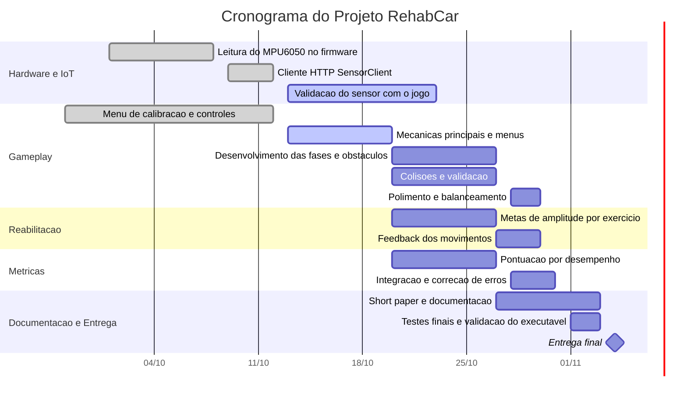

## 📅 Cronograma do Projeto

**Última atualização:** 13/10/2026  
**Prazo de entrega:** 04/11/2026

O cronograma apresenta as etapas de desenvolvimento do RehabCar, incluindo hardware/IoT, gameplay, funcionalidades de reabilitação, métricas e entrega final.

> **Observação:** as datas das atividades detalhadas são estimativas. O status deve ser atualizado conforme o progresso real da equipe.

### 📊 Cronograma Gantt

### 📌 Etapas e prazos

| Etapa | Prazo | Status |
|---|---|---|
| Ideação, viabilidade e planejamento inicial | 02/10/2026 | ✅ Concluído |
| Configuração da base em libGDX e cronograma | 06/10/2026 | ✅ Concluído |
| Hardware, menus e integração com o MPU6050 | 13/10/2026 | ✅ Concluído |
| Mecânicas principais, menus e início das fases | 20/10/2026 | 🔄 Em andamento |
| Fases, obstáculos, colisões e metas de reabilitação | 27/10/2026 | ⬜ Planejado |
| Short paper e documentação | 03/11/2026 | ⬜ Planejado |
| Testes finais e entrega do executável | 04/11/2026 | ⬜ Planejado |

### 🎯 Marcos do projeto

- **13/10:** base técnica, menus e integração inicial do sensor.
- **20/10:** mecânicas principais e controles direcionais.
- **27/10:** fases, obstáculos, colisões e funcionalidades de reabilitação.
- **03/11:** documentação, short paper e preparação do executável.
- **04/11:** entrega final do projeto.

### 📝 Observações

- Validar a comunicação entre o ESP32, o MPU6050 e o jogo.
- Garantir que a calibração e os controles direcionais funcionem corretamente.
- Integrar as metas de movimento e a pontuação às mecânicas do jogo.
- Realizar testes integrados antes da entrega.
- Atualizar os status e as datas conforme o progresso real da equipe.

**Legenda:** `done` = concluído · `active` = em andamento · sem marcador = planejado.