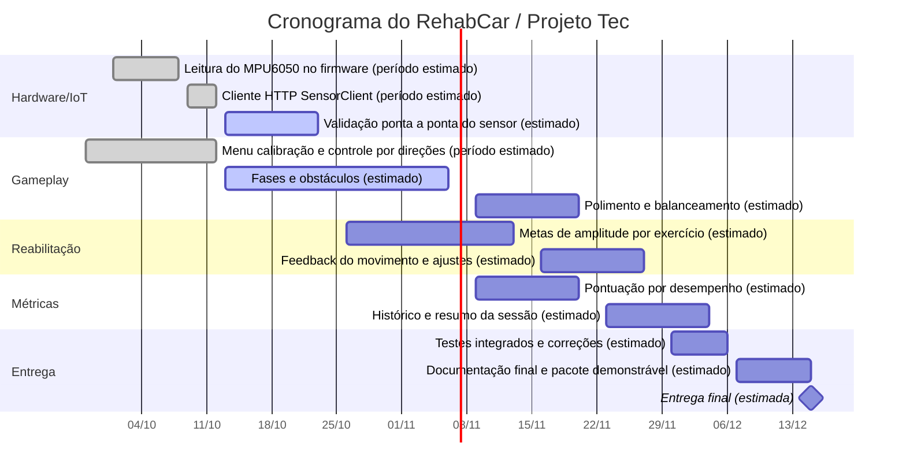

# Cronograma do projeto

> **Premissa (estimada):** como a data final e as datas intermediárias não foram informadas, este cronograma considera a entrega em **15/12/2026**. Todas as datas, inclusive os períodos atribuídos às etapas já concluídas, são estimadas. As etapas ainda não descritas em detalhe também são estimativas e devem ser confirmadas.

| Fase | Prazo | Status |
|---|---|---|
| Ideação, viabilidade e planejamento inicial | 02/10/2026 | ✅ |
| Setup Base (libGDX) e cronograma | 06/10/2026 | ✅ |
| Hardware, Menus e integração MPU6050 | 13/10/2026 | ✅ |
| Mecânicas Core, Finalizar Menus, Iniciar fases| 20/10/2026 | 🔄 |
| Fases, obstáculos, colisões e validação  e metas de reabilitação | 27/10/2026 | ⬜ |
| Short Paper e Documentação | 03/11/2026 | ⬜ |
| Testes finais e Entrega do Executável | 04/11/2026 | ⬜ |

✅ indica concluído · 🔄 indica ativo · ⬜ indica futuro.
Última atualização: 13/10/2026
